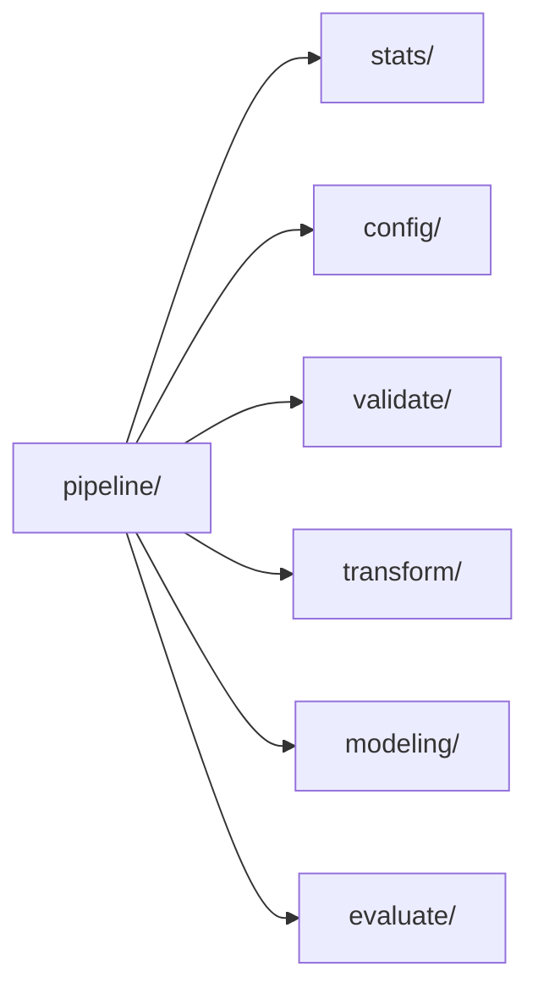

# multi-time

<p align="center">
  <a href="https://github.com/docxology/multi-time/actions/workflows/ci.yml"></a>
  <a href="LICENSE"></a>
  
</p>

**Comprehensive multi-frequency time series analysis toolkit** built on the [sktime](https://github.com/sktime/sktime) ecosystem.

Handles multi-frequency data, patchy/irregular series, descriptive statistics, statistical testing, and state-of-the-art forecasting — all configurable, modular, and fully tested.

## Features

- **Data I/O** — CSV loading, sample data generators (daily, monthly, patchy, irregular)
- **Validation** — data quality checks, frequency detection, gap/patchiness analysis, multi-series harmonization
- **Descriptive Statistics** — mean/std/skew/kurtosis, ACF/PACF, rolling stats, seasonal decomposition
- **Statistical Tests** — ADF, KPSS, Shapiro-Wilk, Jarque-Bera, seasonality strength, ARCH, Granger causality
- **Transformations** — imputation, detrending, deseasonalization, Box-Cox, differencing, lags (via sktime)
- **Forecasting** — Naive, Exponential Smoothing, Theta, AutoARIMA, SARIMAX, Ensemble, grid search tuning
- **Probabilistic** — prediction intervals, quantile forecasts, distribution fitting with AIC/BIC
- **Metrics** — MAE, MSE, MAPE, MdAPE, MASE, RMSSE, RMSE
- **Visualization** — time series plots, forecast comparison, ACF/PACF, decomposition, diagnostics, residuals
- **Pipeline** — configurable end-to-end: validate → describe → test → transform → forecast → evaluate

## Installation

```bash
# Using uv (recommended)
uv venv && uv pip install -e ".[dev]"

# Core only
uv pip install -e .

# With all extras
uv pip install -e ".[all,dev]"
```

## Quick Start

```python
from multi_time import MultiTimePipeline, MultiTimeConfig
from multi_time.data import generate_daily_series

# Generate sample data
data = generate_daily_series(n=365, trend=0.1)
train, test = data.iloc[:-30], data.iloc[-30:]

# Run pipeline
config = MultiTimeConfig(models=["naive", "exp_smoothing"], forecast_horizon=30)
pipeline = MultiTimePipeline(config)
result = pipeline.run(train, test)
```

## Project Structure

```text
multi-time/
├── src/multi_time/
│   ├── config/          # Configuration + logging
│   │   ├── settings.py  # MultiTimeConfig dataclass
│   │   └── logging.py   # Structured logging
│   ├── data/            # Data I/O + generators
│   │   ├── loaders.py   # CSV loading
│   │   └── generators.py # Sample data factories
│   ├── validate/        # Validation + frequency detection
│   │   └── validators.py
│   ├── stats/           # Descriptive + inferential
│   │   ├── descriptive.py
│   │   └── tests.py
│   ├── transform/       # sktime transformer wrappers
│   │   └── transformers.py
│   ├── modeling/        # Forecasting + probabilistic
│   │   ├── forecasters.py
│   │   └── probabilistic.py
│   ├── evaluate/        # Metrics
│   │   └── metrics.py
│   ├── visualization/   # Plotting + diagnostics
│   │   └── plots.py
│   └── pipeline/        # End-to-end orchestrator
│       └── __init__.py
├── scripts/             # Thin CLI orchestrators
├── tests/               # pytest suite (180 tests)
├── docs/                # Documentation
└── pyproject.toml
```

### Package map

Generated on 2026-11-12 from the `import` statements under `src/multi_time/`. An arrow from A to B means code in A imports B; arrows already implied by a longer path are left out, so the picture shows layering rather than every edge. It shows 7 of the package's 9 top-level parts: the largest ones that import or are imported by others.



## Subpackage Imports

```python
# Direct subpackage access
from multi_time.data import generate_daily_series
from multi_time.validate import validate_series, assess_patchiness
from multi_time.stats import compute_descriptive_stats, test_stationarity
from multi_time.transform import build_transform_pipeline
from multi_time.modeling import create_forecaster, run_forecast, predict_intervals
from multi_time.evaluate import evaluate_forecast
from multi_time.visualization import plot_forecast, plot_diagnostics

# Or via root (backward compatible)
from multi_time import validate_series, create_forecaster, evaluate_forecast
```

## sktime Ecosystem

Built on and integrates with:

- [sktime](https://github.com/sktime/sktime) — core time series ML
- [skpro](https://github.com/sktime/skpro) — probabilistic modeling (optional)
- [skbase](https://github.com/sktime/skbase) — base classes and utilities
- [pytorch-forecasting](https://github.com/sktime/pytorch-forecasting) — deep learning (optional)

## Testing

```bash
uv run pytest tests/ -v
```

## Documentation

See [docs/](docs/) for architecture, API reference, configuration, and examples.

## License

MIT
